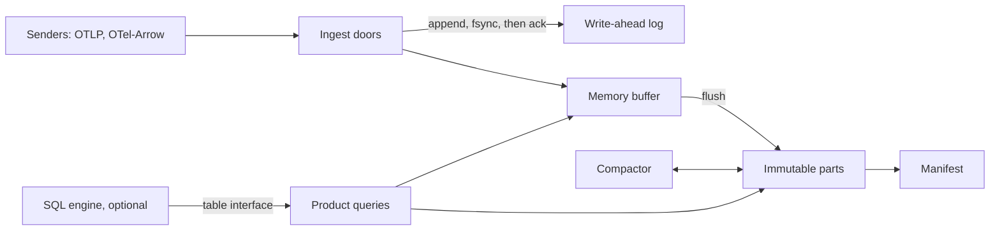

# Design

This document states what NightwatchDB is, the choices that shape it, and why
each was made. Where a choice was tested, the experiment is named; the
measurements are in [benchmarks](benchmarks/README.md).

## Scope

A self-hosted database for OpenTelemetry traces, logs and metrics, tuned for
LLM and agent traces. It is an analytical, append-only store with two access
patterns that ordinary analytical stores serve badly: fetching one whole trace,
and searching text.

Out of scope for now: PromQL, multi-node clustering, multi-statement
transactions.

## The data it is built for

- A span of an agent trace carries tens of kilobytes of text; a trace carries
  megabytes; long agent runs reach hundreds of megabytes.
- 92 to 97% of that text repeats earlier spans of the same trace, because each
  model call re-sends its whole context. System prompts and tool definitions
  also repeat across traces.
- Spans of a trace arrive over minutes to hours.
- Scores, annotations and feedback are attached to spans long after they were
  written.
- Instrumentation conventions for this data are still changing.

## Architecture



**Write path.** A request is decoded once, appended to the write-ahead log,
and acknowledged after the log is synced. Its spans go into a memory buffer
that is already queryable. When the buffer reaches its byte budget it is
written out as immutable parts, the manifest is advanced, and the log is
trimmed. A compactor merges parts in the background.

**Read path.** A reader takes a snapshot: one manifest version plus the
current buffer. Files never change after they are written, so readers and
writers do not wait for each other and there are no row locks.

**Two query paths.** The product's own queries (open a trace, list traces,
aggregate, search) run on a small purpose-built executor. Ad-hoc SQL will run
on an embedded SQL engine that sees the storage only as tables returning Arrow
batches. If that engine changes or is removed, the product queries are
unaffected.

## On-disk layout

```
<data dir>/
  wal/                       write-ahead log files
  manifest/                  numbered manifest files, never overwritten
  parts/<part id>/           one immutable part
    spans.parquet            span rows; a trace's spans are adjacent
    traces.idx               trace id -> row range, for one-lookup trace open
    summary.parquet          one row per trace, in start-time order
    payload.*                large text, each distinct piece stored once
    text.*                   inverted index over the distinct pieces
```

A part covers one time window (15 minutes by trace start). Retention removes
whole windows.

## Decisions

| # | Decision | Why |
|---|---|---|
| 1 | Immutable, time-windowed parts; a trace's spans kept together; a trace index and a per-trace summary | Fastest trace open, cheap trace-level filters, no sort needed at write time. Tested against a service-sorted layout, a trace-id-sorted layout and ClickHouse (experiment A). |
| 2 | Parquet for span columns; purpose-built files for large text | Parquet is an open specification that other tools can read. Large values fit it badly. |
| 3 | Large text stored out of line, split into pieces, each distinct piece stored once per time window | Smallest of four stores tested, least memory to build, fast single-span reads (experiment A). Sharing within a window captures nearly all the repetition, so no global index is needed. |
| 4 | Our own inverted index, one document per distinct piece, no word positions | A fifth the size and a seventeenth of the build cost of indexing spans; phrase search stays fast because a piece is verified once (experiment B). |
| 5 | Attribute names stored as sent; a few dozen important fields also copied into typed columns at ingest; older and newer names mapped from a table generated from the OpenTelemetry semantic conventions | Conventions change. Raw data is never lost, common queries stay fast. |
| 6 | Scores, annotations and deletes as append-only overlay files merged at read time | Keeps files immutable; no transactions needed. |
| 7 | Atomic batch commit, snapshot reads, duplicate-safe ingest; no multi-statement transactions | Telemetry is append-only. |
| 8 | Manifest as numbered files written with create-if-absent | The one primitive that behaves the same on a local disk and on every object store. |
| 9 | Every buffer sized by bytes, never by rows | Rows range from 1 KB to megabytes. A row-based batch was killed for memory in testing. |
| 10 | Rust | The embedded SQL engine exists only there. Write-path speed was a tie with Go in a direct comparison; selective reads were several times faster with the Rust Parquet library. |
| 11 | Own receivers for OTLP and OTel-Arrow | Both interoperate with the OpenTelemetry Collector in testing (experiment C). OTel-Arrow sends about a fifth of the bytes on text-heavy traces and costs more memory and CPU at the receiver. |
| 12 | No external runtime services | One process with a disk or a bucket. |
| 13 | One repository; crates in layers that depend only downward | A change across storage and index is one commit. A crate can move to its own repository when something outside needs it. |

## Crate layers

A crate may depend only on crates in lower layers.

| Layer | Crates |
|---|---|
| 5 | `nightwatchdb` (the binary) |
| 4 | `nwdb-sql` (the only crate that uses the SQL engine; optional) |
| 3 | `nwdb-engine`, `nwdb-otlp`, `nwdb-otap` |
| 2 | `nwdb-manifest`, later: summaries, entity graph |
| 1 | `nwdb-wal`, `nwdb-segment`, `nwdb-payload`, `nwdb-textindex` |
| 0 | `nwdb-core`, later: `nwdb-semconv` |

Crates are added when their feature is built.

## Open items

- The summary is ordered by time only, so "newest traces for one service" is
  slower than it should be.
- The OTel-Arrow receiver holds the sender's dictionaries and copies them as
  they grow; on text-heavy data it uses far more memory and CPU than the OTLP
  receiver.
- Object-store backend, compaction policy and retention are designed and not
  yet built.
- Profiles are planned as a later signal.
